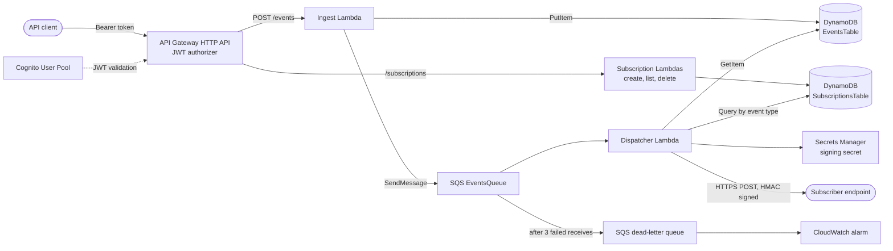

# Dispatch Webhook Engine

A serverless webhook delivery service on AWS. Clients send events to an
authenticated API. The service stores each event durably, then delivers it to
every HTTPS endpoint subscribed to that event type, signed with HMAC-SHA256,
with retries and a dead-letter queue for failures.

Built with TypeScript and AWS CDK as a portfolio project, using a production-style
workflow: protected `main`, CI on every pull request, test-driven development,
least-privilege IAM, and verification against a real deployed stack.

## Highlights

- **Authenticated API.** Cognito-issued JWTs on every route, with users created
  only by an administrator.
- **Fast, durable ingestion.** `POST /events` writes to DynamoDB, queues the event
  in SQS, and returns `202`. Slow or failing subscribers never affect the API.
- **Signed delivery.** Each webhook carries an HMAC-SHA256 signature and a stable
  `X-Webhook-Event-Id` so subscribers can verify and deduplicate.
- **Failure handling.** Retries with exponential backoff for transient errors,
  per-message retry through SQS, a dead-letter queue, and a CloudWatch alarm on it.
- **Least-privilege IAM.** One role per Lambda, limited to the actions that function
  needs. The only account-wide wildcard is X-Ray's, documented below.
- **Tested at two levels.** 79 unit tests and a 10-test integration suite that runs
  against a deployed stack, including an end-to-end delivery check.
- **Observable.** Structured JSON logs and X-Ray tracing, with an `eventId` that
  correlates the functions.

## Architecture



**How an event flows**

1. A client calls `POST /events` with a JWT. API Gateway validates the token
   before any code runs.
2. The Ingest Lambda validates the body, stores the event in DynamoDB with status
   `PENDING`, and sends its `eventId` to SQS. It returns `202` with the `eventId`.
3. The Dispatcher Lambda receives the message, loads the event, and looks up
   subscribers for its event type through a global secondary index.
4. For each subscriber it sends an HTTPS `POST` with the payload, signed with a
   secret held in Secrets Manager. Subscribers are called in parallel.
5. Transient failures are retried in place (up to 3 attempts with backoff). If any
   delivery still fails, the message returns to the queue, and after 3 receives it
   moves to the dead-letter queue, which triggers a CloudWatch alarm.

## Tech stack

TypeScript, AWS CDK, AWS Lambda (Node.js 22), API Gateway HTTP API, DynamoDB, SQS,
Cognito, Secrets Manager, CloudWatch, X-Ray, Jest, ESLint, Prettier, Husky, and
GitHub Actions.

## Engineering decisions

**SQS between ingestion and delivery.** Delivering to third-party URLs inside the
request would tie API availability and latency to the slowest subscriber. Ingest
only has to store and enqueue, so it stays fast. SQS also provides retries and the
dead-letter queue.

**HTTP API instead of REST API.** The API is a Lambda proxy with JWT auth, which an
HTTP API handles at lower cost and latency. The trade-off is that HTTP APIs have
no X-Ray support, so traces begin at the Ingest function.

**A failed enqueue returns `500`.** If the event is stored but the SQS send fails,
Ingest returns `500` and doesn't claim success for an event that won't be
delivered. I verified this on a live stack by inducing the failure. The cost is
that a client retry creates a new event, since IDs are generated server-side, and
the first event remains stored as `PENDING`. An idempotency key would fix this
(see "What I'd do next").

**Partial batch failure with batch size 1.** The Dispatcher reports failed messages
individually, so only those are retried. Batch size 1 keeps the worst-case run time
inside the 30-second Lambda timeout, and the queue's visibility timeout is 6x that
(180 seconds), following AWS guidance.

**Retries only where they can help.** Network errors, timeouts, `5xx`, `408`, and
`429` are retried. Other `4xx` responses fail immediately, since retrying a
rejected request wastes time.

**Ownership comes from the token.** A subscription's owner is the JWT `sub` claim,
never a field in the request body, so a caller can only read or change their own
subscriptions. Verified with two users in the integration suite.

**Least privilege, with one documented exception.** Each function has its own role
limited to the actions it needs. The three subscription functions hold exactly one
DynamoDB action each. Enabling X-Ray adds `xray:PutTraceSegments` and
`xray:PutTelemetryRecords` on `Resource: '*'`, because X-Ray doesn't support
resource-level permissions.

**Tests that can fail.** Stack tests assert on each function's own role and were
checked by mutation: break the code on purpose and confirm a test goes red. A bug
the unit tests missed (an SQS attribute with the wrong casing, which made Ingest
return `500`) was caught by running against the deployed stack.

## API reference

All routes require `Authorization: Bearer <access token>`. Errors: `400` for invalid
input, `401` for a missing or invalid token, `500` for server errors.

| Method   | Path                         | Description                                                            | Success                           |
| -------- | ---------------------------- | ---------------------------------------------------------------------- | --------------------------------- |
| `POST`   | `/events`                    | Submit an event: `{ "eventType": "...", "payload": { ... } }`          | `202` with `{ "eventId": "..." }` |
| `POST`   | `/subscriptions`             | Register a webhook URL: `{ "eventType": "...", "url": "https://..." }` | `201`                             |
| `GET`    | `/subscriptions`             | List your subscriptions                                                | `200`                             |
| `DELETE` | `/subscriptions/{eventType}` | Remove a subscription (`204` even if none existed)                     | `204`                             |

**Subscription rules.** `url` must use `https:`, carry no embedded credentials, and
not be `localhost`, a private or loopback IPv4 address, or an IPv6 literal.
`eventType` is 1 to 256 characters from `A-Z a-z 0-9 . _ : -`.

## Webhook delivery

Subscribers receive a `POST` with the event payload as JSON and two headers:

- `X-Webhook-Signature`: hex-encoded HMAC-SHA256 of the request body
- `X-Webhook-Event-Id`: the event's ID, identical across every retry of that event

Verify the signature against the raw request body:

```typescript
import { createHmac, timingSafeEqual } from 'crypto';

function isValidSignature(
  rawBody: string,
  secret: string,
  received: string
): boolean {
  const expected = createHmac('sha256', secret).update(rawBody).digest('hex');
  const a = Buffer.from(expected);
  const b = Buffer.from(received);
  return a.length === b.length && timingSafeEqual(a, b);
}
```

A message can be redelivered when another subscriber on the same event fails, so
subscribers should deduplicate on `X-Webhook-Event-Id`.

## Getting started

### Prerequisites

- Node.js 22 (`nvm use` reads `.nvmrc`)
- AWS CLI configured with credentials that can deploy CloudFormation stacks
- A one-time `npx cdk bootstrap` for your account and region

The stack deploys to the region your CLI is configured for. It was developed in
`us-east-1`.

### Install and deploy

```bash
git clone https://github.com/stvnpalma/dispatch-webhook-engine.git
cd dispatch-webhook-engine
nvm use
npm install
npx cdk deploy
```

The deploy prints four outputs: `ApiUrlOutput`, `UserPoolIdOutput`,
`UserPoolClientIdOutput`, and `WebhookSecretArnOutput`.

### Try it

Self sign-up is disabled, so create a user, then get an access token. The password
must satisfy Cognito's default policy (8+ characters with upper and lower case, a
digit, and a symbol) and shouldn't contain a comma.

```bash
API_URL=<ApiUrlOutput>
POOL_ID=<UserPoolIdOutput>
CLIENT_ID=<UserPoolClientIdOutput>
PASSWORD='Replace-With-A-Passw0rd!'

aws cognito-idp admin-create-user --user-pool-id "$POOL_ID" \
  --username demo-user --message-action SUPPRESS
aws cognito-idp admin-set-user-password --user-pool-id "$POOL_ID" \
  --username demo-user --password "$PASSWORD" --permanent

TOKEN=$(aws cognito-idp initiate-auth --auth-flow USER_PASSWORD_AUTH \
  --client-id "$CLIENT_ID" \
  --auth-parameters "USERNAME=demo-user,PASSWORD=$PASSWORD" \
  --query 'AuthenticationResult.AccessToken' --output text)
```

Register a subscriber (any public HTTPS endpoint; [webhook.site](https://webhook.site)
gives you a free one), then send an event:

```bash
curl -i -X POST "$API_URL/subscriptions" \
  -H "Authorization: Bearer $TOKEN" -H "Content-Type: application/json" \
  -d '{"eventType":"order.shipped","url":"https://webhook.site/<your-id>"}'

curl -i -X POST "$API_URL/events" \
  -H "Authorization: Bearer $TOKEN" -H "Content-Type: application/json" \
  -d '{"eventType":"order.shipped","payload":{"orderId":"12345"}}'
```

The second call returns `202` and the signed webhook arrives at your endpoint
within seconds. To check the signature yourself, fetch the secret:

```bash
aws secretsmanager get-secret-value --secret-id <WebhookSecretArnOutput> \
  --query SecretString --output text
```

Access tokens expire after an hour. Rerun the `initiate-auth` command to get a new one.

### Tear down

```bash
npx cdk destroy
```

Application resources use a `DESTROY` removal policy and are removed with the stack.
The CDK bootstrap resources are shared and are left in place.

## Testing

| Suite                  | Command                    | What it covers                                                                              |
| ---------------------- | -------------------------- | ------------------------------------------------------------------------------------------- |
| Unit (79 tests)        | `npm test`                 | Infrastructure assertions, input validation, retry logic, header and trace helpers          |
| Integration (10 tests) | `npm run test:integration` | Auth, subscription lifecycle, ownership, and signed end-to-end delivery on a deployed stack |

The integration suite is run manually against a deployed stack, since CI has no AWS
environment. Copy `.env.example` to `.env.local` and fill it from the deploy outputs:

| Variable                                                               | Source                                        |
| ---------------------------------------------------------------------- | --------------------------------------------- |
| `API_URL`, `USER_POOL_ID`, `USER_POOL_CLIENT_ID`, `WEBHOOK_SECRET_ARN` | Stack outputs                                 |
| `AWS_REGION`                                                           | The region you deployed to                    |
| `TEST_USER_PASSWORD`                                                   | A throwaway password meeting the policy above |

The suite creates and deletes two Cognito users per run and calls Cognito and
Secrets Manager directly, so your AWS credentials need access to both.

## Development workflow

- `main` is protected: pull requests only, a required status check, linear history,
  and no admin bypass. Work happens on feature branches into `dev`.
- GitHub Actions runs lint, type-check, unit tests, and a formatting check on every
  pull request.
- A pre-commit hook (Husky and lint-staged) runs ESLint and Prettier on staged files
  and blocks stray JavaScript files.
- Commits follow Conventional Commits. See [CONTRIBUTING.md](CONTRIBUTING.md).

```text
bin/            CDK app entry point
lib/            The stack: every AWS resource
lambda/
  ingest/       POST /events
  dispatch/     SQS consumer: delivery, retry, headers
  subscriptions/  create, list, delete, validation
  shared/       trace helpers
test/           Unit tests
integration/    Integration tests and setup
postman/        Postman collection with valid and invalid examples
```

## Known limitations

- **Event status never changes.** Events stay `PENDING`; delivery outcomes appear in
  logs and the dead-letter queue, not on the record.
- **No idempotency key.** A client retry creates a new event, and a failed enqueue
  can leave an orphaned `PENDING` event.
- **Whole-message retry.** If one of several subscribers fails, all of them receive
  the event again. Subscribers deduplicate on `X-Webhook-Event-Id`.
- **One shared signing secret,** with no per-subscriber secrets or rotation. The
  integration test verifies signatures for a flat payload only.
- **Not full SSRF protection.** URL validation blocks IP literals and `localhost`,
  not hostnames that resolve to private addresses.
- **Password auth flow.** It stands in for machine clients, whose proper pattern is
  OAuth client credentials. No MFA or hosted sign-in.
- **Tracing.** HTTP APIs don't support X-Ray, so traces start at the Ingest
  function, and the Ingest and Dispatcher traces are linked rather than merged.
- **Operations gaps.** The dead-letter alarm has no notification target. There is
  no pagination on `GET /subscriptions` and no custom throttling or WAF.
- **`/events` accepts any event type,** including ones that can't be subscribed to.
- **Integration tests** depend on webhook.site and run manually, not in CI.

## What I'd do next

1. An idempotency key on `POST /events`, plus status updates and a job that
   re-enqueues orphaned `PENDING` events.
2. Per-subscriber signing secrets and rotation.
3. OAuth client credentials for machine clients.
4. SNS notifications for the dead-letter alarm.
5. SDK client instrumentation for DynamoDB and SQS spans in X-Ray.
6. A self-hosted delivery receiver so integration tests can run in CI.
